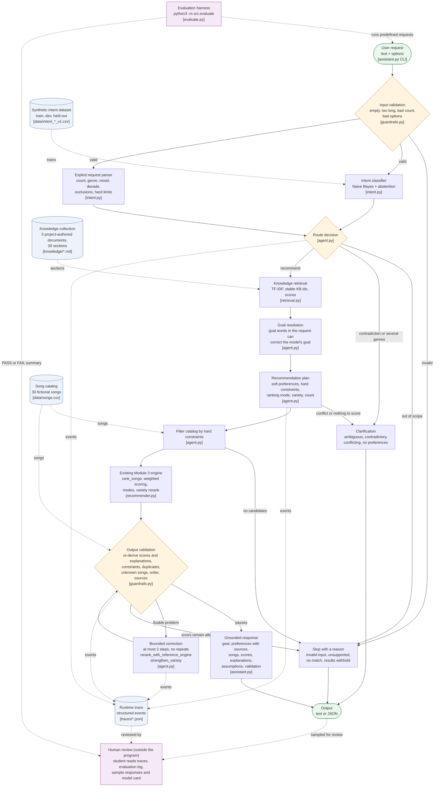

# VibeFinder AI: Intelligent Music Discovery Assistant

VibeFinder AI lets you describe what you want to listen to in plain language (*"Find calm instrumental music for studying"*) and returns recommendations from a fictional 30-song catalog, together with the plan it used, an exact score breakdown for every song, the knowledge sources behind its assumptions, and the result of its own validation checks.

It extends my completed Module 3 **Music Recommender Simulation** without replacing it: the original scoring engine does all the ranking. Around it sit a small intent classifier, a local knowledge retrieval index, a bounded tool-calling agent, guardrails that can reject or correct bad output, and an executable evaluation harness.

> **What this is not.** It is not a large language model and does not understand arbitrary language. The intent model is a small Naive Bayes text classifier trained on a synthetic dataset I wrote for this project; responses are deterministic templates filled from retrieved project-authored text. Every song and number is fictional, so none of this is a real streaming recommendation.

Documents: [model_card.md](model_card.md) (responsible-AI reflection, data, evaluation) · [ai_interactions.md](ai_interactions.md) (AI collaboration log and runtime traces) · [docs/presentation.md](docs/presentation.md) (5–7 minute talk outline) · [docs/design.md](docs/design.md) (design notes) · [diagrams/architecture.mmd](diagrams/architecture.mmd) (Mermaid source) · [traces/](traces/README.md) (committed runtime traces)

## Contents

1. [Original project](#original-project)
2. [New applied AI features](#new-applied-ai-features)
3. [Architecture](#architecture)
4. [Setup and commands](#setup-and-commands)
5. [Reproducible execution evidence](#reproducible-execution-evidence)
6. [Retrieval](#retrieval)
7. [Agent workflow](#agent-workflow)
8. [Reliability and evaluation](#reliability-and-evaluation)
9. [Design decisions](#design-decisions)
10. [Limitations and future improvements](#limitations-and-future-improvements)
11. [Brief reflection](#brief-reflection)
12. [Portfolio artifact](#portfolio-artifact)

## Original project

The starting point is the **Module 3 Music Recommender Simulation** ([original repository](https://github.com/ONATEMOWO/ai110-module3show-musicrecommendersimulation-starter), documentation preserved in [docs/module3/](docs/module3/README.md)). Its goal was a small, fully transparent, content-based recommender: it reads 30 fictional songs with 15 attributes from `data/songs.csv`, compares each song with a listener's *structured* preferences (genre, mood, target energy and optional targets such as valence or tempo), and returns the top matches with the exact points behind every score. It offers functional and object-oriented interfaces over one scoring rule, three ranking modes (`balanced`, `genre-first`, `mood-energy`), an optional variety rerank that penalises repeated artists or genres, and a table-formatted CLI (`python3 -m src.main`).

What it could not do: read a sentence, apply a hard filter, or check its own output. The 210 original tests and the original entry point are unchanged:

```text
$ python3 -m src.main --width 80
Loaded 30 songs from data/songs.csv
Mode: balanced - genre, mood and energy all count (default)
Variety penalty: off (baseline: ranked by score alone)

=== Happy high-energy pop listener ===
Preferences: genre=pop, mood=happy, energy=0.85, likes_acoustic=False
Top 5 (a perfect match would score 6.00):
# | Song             | Artist       | Score | Why (points)
--+------------------+--------------+-------+-----------------------------------
1 | Sunrise City     | Neon Echo    |  5.85 | genre match: pop (+2.00)
  |                  |              |       | mood match: happy (+1.50)
  |                  |              |       | energy 0.82 vs target 0.85 (+1.94)
...
```

## New applied AI features

| Feature | What it does | Where |
|---|---|---|
| **Natural-language requests** | Turns text into an explicit plan: listening goal, soft preferences (scoring targets), hard constraints (filters), ranking mode, variety and result count | [src/assistant.py](src/assistant.py), [src/agent.py](src/agent.py) |
| **Knowledge retrieval (RAG-style)** | A TF-IDF index over 39 sections of project-authored guidance with stable `KB-*` IDs. Retrieved sections *build the plan* (preference targets, ranking mode, variety) and supply the cited notes; they are never just printed next to unchanged results | [knowledge/](knowledge), [src/retrieval.py](src/retrieval.py) |
| **Specialized intent model** | A multinomial Naive Bayes classifier (standard library) trained on a versioned synthetic dataset, with abstention, compared against a keyword baseline on a separate held-out file | [src/intent.py](src/intent.py), [data/intent_dataset.md](data/intent_dataset.md) |
| **Bounded agent** | A tool-calling workflow with explicit branches and at most two corrective steps; every step writes a structured runtime event | [src/agent.py](src/agent.py), [traces/](traces/README.md) |
| **Guardrails** | Request checks and a result validator that re-derives every score and explanation with the Module 3 scorer, enforces hard constraints, and checks duplicates, unknown songs, ordering and cited sources. Failures trigger a correction, a clarification or withheld output | [src/guardrails.py](src/guardrails.py) |
| **Evaluation harness** | `python3 -m src.evaluate` runs predefined cases and prints PASS/FAIL, a classifier comparison, a retrieval on/off comparison and a guardrail fault-injection comparison; exits non-zero on failure | [src/evaluate.py](src/evaluate.py) |

Why it matters: a recommender is only useful if people can ask for what they want, and only trustworthy if it says what it assumed and can detect its own mistakes. These additions make assumptions visible (every inferred preference carries the ID of the knowledge section it came from), make explicit wording override inference, and make wrong output detectable.

## Architecture

Source: [diagrams/architecture.mmd](diagrams/architecture.mmd) (this block is identical to that file; `tests/test_diagram.py` checks that).



Data flow in words:

1. **Input**: the CLI passes the request text and options (count, mode, goal, `--prefer`, `--require`, variety, retrieval on/off).
2. **Processing**: input validation → intent classifier and explicit-request parser → routing → retrieval → goal resolution → plan → hard-constraint filter → the unchanged Module 3 `rank_songs` → output validation → at most two corrective steps.
3. **Output**: a grounded text (or JSON) response, a clarification, or a stop with a reason, plus a structured runtime trace. The evaluation harness and a human reviewer sit outside the runtime path.

## Setup and commands

Prerequisites: Python 3.10 or newer (developed and tested with 3.12.0). No API keys, accounts, network access or model downloads are needed; the only dependency is `pytest`.

```bash
git clone https://github.com/ONATEMOWO/applied-ai-system-final.git
cd applied-ai-system-final

python3 --version                                   # 3.10 or newer
python3 -m venv .venv && source .venv/bin/activate  # optional but recommended
python3 -m pip install -r requirements.txt          # installs pytest only

python3 -m src.main                                 # the original Module 3 demo (unchanged)
python3 -m src.assistant --help                     # the new assistant
python3 -m src.assistant --query "Find calm instrumental music for studying"
python3 -m src.assistant --demo                     # three example requests in a row
python3 -m src.evaluate                             # evaluation harness (exit status 1 on any failure)
python3 -m src.evaluate --write-traces traces       # also regenerate the committed runtime traces
python3 -m pytest                                   # 501 tests, including the original 210
```

Controls for the assistant (`python3 -m src.assistant --help` shows the same):

| Option | Meaning |
|---|---|
| `-q, --query TEXT` | the request in plain language |
| `-n, --count N` | number of songs, 1 to 15 (default 5; wording such as "top 3" also works) |
| `--mode {balanced,genre-first,mood-energy}` | ranking strategy; otherwise chosen by the request wording or goal profile |
| `--goal {study,workout,party,relax,discovery}` | set the listening goal yourself instead of using the intent model |
| `--prefer KEY=VALUE` | explicit soft preference that overrides inferred ones (`energy=0.9`, `genre=jazz`, `likes_acoustic=true`); repeatable |
| `--require FEATURE<=N` / `FEATURE>=N` | hard limit, e.g. `energy<=0.5`, `tempo>=120`; songs that fail are removed; repeatable |
| `--exclude-genre GENRE` | hard genre exclusion; repeatable |
| `--artist-penalty P`, `--genre-penalty P` | variety rerank strength (points subtracted per repeat) |
| `--no-retrieval` | do not use the knowledge collection |
| `--compare-retrieval` | run the request with and without retrieval and print the difference |
| `--trace`, `--trace-file PATH` | print the runtime events, or save them as JSON (this stores the request text) |
| `--json`, `--format {table,list}`, `--width N` | output controls |
| `--demo` | run three example requests |

Exit status: `0` the request was handled (including a clarification, an out-of-scope notice or an honest "no match"), `1` results were withheld because validation failed, `2` invalid input.

## Reproducible execution evidence

Every block below is **real output**, produced by the command on its first line. `tests/test_readme_evidence.py` re-runs each command and fails if this README and the program disagree, so these cannot silently go stale. Output is deterministic (no timestamps, no randomness).

### Interaction 1: study

*"Find calm instrumental music for studying."* The intent model says `study`; retrieval supplies the goal profile (`KB-GOAL-STUDY`) and two phrase modifiers (`KB-MOD-CALM`, `KB-MOD-INSTRUMENTAL`). "Calm" replaces the profile's energy and tempo targets (the replaced values are shown), the table shows the exact points behind each score, and every cited source is listed.

```text
$ python3 -m src.assistant --query "Find calm instrumental music for studying"
VibeFinder AI
=============
Request : Find calm instrumental music for studying
Status  : ok
Goal    : study (intent model; relative score 0.99, not a calibrated probability)

Plan (what the ranking engine was asked to do)
  Soft inferred preferences (scoring targets, never filters):
    mood = focused   [inferred: KB-GOAL-STUDY]
    likes_acoustic = yes   [inferred: KB-GOAL-STUDY]
    energy = 0.3   [inferred: KB-MOD-CALM; replaces KB-GOAL-STUDY=0.4]
    tempo_bpm = 75   [inferred: KB-MOD-CALM; replaces KB-GOAL-STUDY=80]
    instrumentalness = 0.85   [inferred: KB-GOAL-STUDY]
  Hard constraints: none
  Ranking mode: balanced (from KB-GOAL-STUDY)
  Variety penalty: off
  Candidates: 30 of 30 songs passed the hard constraints

Top 5; a perfect match would score 5.00:
# | Song                  | Artist           | Score | Why (points)
--+-----------------------+------------------+-------+----------------------------------------------
1 | Focus Flow            | LoRoom           |  4.63 | mood match: focused (+1.50)
  |                       |                  |       | energy 0.40 vs target 0.30 (+1.80)
  |                       |                  |       | tempo 80 vs target 75 (+0.46)
  |                       |                  |       | instrumentalness 0.88 vs target 0.85 (+0.48)
  |                       |                  |       | acousticness 0.78, wants acoustic (+0.39)
--+-----------------------+------------------+-------+----------------------------------------------
2 | Library Rain          | Paper Lanterns   |  3.30 | energy 0.35 vs target 0.30 (+1.90)
  |                       |                  |       | tempo 72 vs target 75 (+0.47)
  |                       |                  |       | instrumentalness 0.85 vs target 0.85 (+0.50)
  |                       |                  |       | acousticness 0.86, wants acoustic (+0.43)
--+-----------------------+------------------+-------+----------------------------------------------
3 | Sunday Slow Dance     | Slow Stereo      |  3.29 | energy 0.34 vs target 0.30 (+1.92)
  |                       |                  |       | tempo 76 vs target 75 (+0.49)
  |                       |                  |       | instrumentalness 0.70 vs target 0.85 (+0.42)
  |                       |                  |       | acousticness 0.90, wants acoustic (+0.45)
--+-----------------------+------------------+-------+----------------------------------------------
4 | Spacewalk Thoughts    | Orbit Bloom      |  3.26 | energy 0.28 vs target 0.30 (+1.96)
  |                       |                  |       | tempo 60 vs target 75 (+0.38)
  |                       |                  |       | instrumentalness 0.92 vs target 0.85 (+0.46)
  |                       |                  |       | acousticness 0.92, wants acoustic (+0.46)
--+-----------------------+------------------+-------+----------------------------------------------
5 | Glass Cathedral       | Aria Voss        |  3.17 | energy 0.22 vs target 0.30 (+1.84)
  |                       |                  |       | tempo 64 vs target 75 (+0.41)
  |                       |                  |       | instrumentalness 0.97 vs target 0.85 (+0.44)
  |                       |                  |       | acousticness 0.96, wants acoustic (+0.48)
--+-----------------------+------------------+-------+----------------------------------------------

Why this plan (project-authored guidance, not external research)
  [KB-GOAL-STUDY] Study sessions usually favour steady, low-distraction, mostly instrumental music
      at moderate-to-low energy.
  [KB-MOD-CALM] "Calm" is read as low energy (0.30) and a slow tempo (about 75 BPM).
  [KB-MOD-INSTRUMENTAL] "Instrumental" is read as a high instrumentalness target (0.85).
  [KB-FEAT-INSTRUMENTALNESS] Instrumentalness (0 to 1) estimates how little singing a song has.
  [KB-FEAT-ENERGY] Energy (0 to 1) is the strongest numeric signal in scoring.
  [KB-POLICY-SYNTHETIC] The catalog is 30 fictional songs; results are not real streaming
      recommendations.
  [KB-POLICY-INFERENCE] Inferred targets are assumptions; explicit wording overrides them and
      unclear requests get a clarification.
  [KB-POLICY-FILTER-BUBBLE] Results favour the closest matches, which can repeat artists and genres;
      the variety rerank is the counterweight.
  [KB-POLICY-COVERAGE] The catalog is small and uneven; the assistant returns fewer songs rather
      than relaxing a hard constraint.

Validation: passed (scores and explanations re-derived, hard constraints, duplicates and sources
            checked)
Sources (retrieval score): KB-GOAL-STUDY (0.29), KB-MOD-CALM (0.26), KB-MOD-INSTRUMENTAL (0.20),
                           KB-FEAT-INSTRUMENTALNESS (0.17), KB-FEAT-ENERGY (0.11),
                           KB-POLICY-SYNTHETIC (fixed note), KB-POLICY-INFERENCE (fixed note),
                           KB-POLICY-FILTER-BUBBLE (fixed note), KB-POLICY-COVERAGE (fixed note)
```

### Interaction 2: workout

*"Give me energetic music for a workout."* The word "energetic" is also a catalog mood, so it becomes an **explicit** preference (`mood = energetic`), while energy, tempo, danceability and acousticness are **inferred** from `KB-GOAL-WORKOUT` and `KB-MOD-HIGH-ENERGY`.

```text
$ python3 -m src.assistant --query "Give me energetic music for a workout" --count 3
VibeFinder AI
=============
Request : Give me energetic music for a workout
Status  : ok
Goal    : workout (intent model; relative score 0.93, not a calibrated probability)

Plan (what the ranking engine was asked to do)
  Soft explicit preferences (scoring targets, never filters):
    mood = energetic   [explicit: your request]
  Soft inferred preferences (scoring targets, never filters):
    likes_acoustic = no   [inferred: KB-GOAL-WORKOUT]
    energy = 0.9   [inferred: KB-MOD-HIGH-ENERGY; replaces KB-GOAL-WORKOUT=0.92]
    danceability = 0.75   [inferred: KB-GOAL-WORKOUT]
    tempo_bpm = 135   [inferred: KB-MOD-HIGH-ENERGY; replaces KB-GOAL-WORKOUT=140]
  Hard constraints: none
  Ranking mode: balanced (from KB-GOAL-WORKOUT)
  Variety penalty: off
  Candidates: 30 of 30 songs passed the hard constraints

Top 3; a perfect match would score 5.00:
# | Song                  | Artist           | Score | Why (points)
--+-----------------------+------------------+-------+----------------------------------------------
1 | Laser Garden          | Pulse Arcade     |  4.84 | mood match: energetic (+1.50)
  |                       |                  |       | energy 0.90 vs target 0.90 (+2.00)
  |                       |                  |       | danceability 0.90 vs target 0.75 (+0.42)
  |                       |                  |       | tempo 128 vs target 135 (+0.44)
  |                       |                  |       | acousticness 0.06, wants non-acoustic (+0.47)
--+-----------------------+------------------+-------+----------------------------------------------
2 | Hyperdrive Heartbeat  | Max Pulse        |  4.76 | mood match: energetic (+1.50)
  |                       |                  |       | energy 0.95 vs target 0.90 (+1.90)
  |                       |                  |       | danceability 0.90 vs target 0.75 (+0.42)
  |                       |                  |       | tempo 140 vs target 135 (+0.46)
  |                       |                  |       | acousticness 0.04, wants non-acoustic (+0.48)
--+-----------------------+------------------+-------+----------------------------------------------
3 | Rust Belt Anthem      | The Gravel Roads |  4.70 | mood match: energetic (+1.50)
  |                       |                  |       | energy 0.84 vs target 0.90 (+1.88)
  |                       |                  |       | danceability 0.58 vs target 0.75 (+0.41)
  |                       |                  |       | tempo 138 vs target 135 (+0.47)
  |                       |                  |       | acousticness 0.15, wants non-acoustic (+0.42)
--+-----------------------+------------------+-------+----------------------------------------------

Why this plan (project-authored guidance, not external research)
  [KB-GOAL-WORKOUT] Workouts usually favour very high energy, a fast driving tempo and a strong
      beat, with little acoustic texture.
  [KB-MOD-HIGH-ENERGY] High-energy wording is read as energy 0.90 and a fast tempo (about 135 BPM).
  [KB-FEAT-ENERGY] Energy (0 to 1) is the strongest numeric signal in scoring.
  [KB-POLICY-SYNTHETIC] The catalog is 30 fictional songs; results are not real streaming
      recommendations.
  [KB-POLICY-INFERENCE] Inferred targets are assumptions; explicit wording overrides them and
      unclear requests get a clarification.
  [KB-POLICY-FILTER-BUBBLE] Results favour the closest matches, which can repeat artists and genres;
      the variety rerank is the counterweight.
  [KB-POLICY-COVERAGE] The catalog is small and uneven; the assistant returns fewer songs rather
      than relaxing a hard constraint.

Validation: passed (scores and explanations re-derived, hard constraints, duplicates and sources
            checked)
Sources (retrieval score): KB-GOAL-WORKOUT (0.28), KB-MOD-HIGH-ENERGY (0.12), KB-FEAT-ENERGY (0.11),
                           KB-POLICY-SYNTHETIC (fixed note), KB-POLICY-INFERENCE (fixed note),
                           KB-POLICY-FILTER-BUBBLE (fixed note), KB-POLICY-COVERAGE (fixed note)
```

### Interaction 3: party, with variety

*"Recommend upbeat party music with different artists."* The intent model labels this request `discovery` (it keys on "recommend" and "artists"), which is wrong. It is kept here because it shows the correction rule working: the model's label has no keyword evidence in the request, exactly one other goal (`party`) does, so the goal is corrected and retrieval is repeated. The phrase "different artists" retrieves `KB-STRAT-DIVERSITY-ARTIST`, which switches on the variety rerank (artist penalty 0.75).

```text
$ python3 -m src.assistant --query "Recommend upbeat party music with different artists" --count 4
VibeFinder AI
=============
Request : Recommend upbeat party music with different artists
Status  : ok
Goal    : party (the intent model said 'discovery' (relative score 0.85), but the request contains
          the party word(s) 'party', so 'party' was used)

Plan (what the ranking engine was asked to do)
  Soft inferred preferences (scoring targets, never filters):
    mood = happy   [inferred: KB-GOAL-PARTY]
    likes_acoustic = no   [inferred: KB-GOAL-PARTY]
    energy = 0.8   [inferred: KB-MOD-UPBEAT; replaces KB-GOAL-PARTY=0.85]
    valence = 0.85   [inferred: KB-GOAL-PARTY]
    danceability = 0.88   [inferred: KB-GOAL-PARTY]
  Hard constraints: none
  Ranking mode: balanced (from KB-GOAL-PARTY)
  Variety penalty: artist 0.75, genre 0 (from KB-STRAT-DIVERSITY-ARTIST)
  Candidates: 30 of 30 songs passed the hard constraints

Top 4; a perfect match would score 5.00:
# | Song                  | Artist           | Score | Why (points)
--+-----------------------+------------------+-------+----------------------------------------------
1 | Fuego en la Calle     | Luna Rivera      |  4.89 | mood match: happy (+1.50)
  |                       |                  |       | energy 0.80 vs target 0.80 (+2.00)
  |                       |                  |       | valence 0.86 vs target 0.85 (+0.49)
  |                       |                  |       | danceability 0.89 vs target 0.88 (+0.49)
  |                       |                  |       | acousticness 0.20, wants non-acoustic (+0.40)
--+-----------------------+------------------+-------+----------------------------------------------
2 | Golden Hour Parade    | Cherry Meridian  |  4.85 | mood match: happy (+1.50)
  |                       |                  |       | energy 0.78 vs target 0.80 (+1.96)
  |                       |                  |       | valence 0.88 vs target 0.85 (+0.48)
  |                       |                  |       | danceability 0.84 vs target 0.88 (+0.48)
  |                       |                  |       | acousticness 0.15, wants non-acoustic (+0.42)
--+-----------------------+------------------+-------+----------------------------------------------
3 | Sunrise City          | Neon Echo        |  4.82 | mood match: happy (+1.50)
  |                       |                  |       | energy 0.82 vs target 0.80 (+1.96)
  |                       |                  |       | valence 0.84 vs target 0.85 (+0.49)
  |                       |                  |       | danceability 0.79 vs target 0.88 (+0.46)
  |                       |                  |       | acousticness 0.18, wants non-acoustic (+0.41)
--+-----------------------+------------------+-------+----------------------------------------------
4 | Rooftop Lights        | Indigo Parade    |  4.70 | mood match: happy (+1.50)
  |                       |                  |       | energy 0.76 vs target 0.80 (+1.92)
  |                       |                  |       | valence 0.81 vs target 0.85 (+0.48)
  |                       |                  |       | danceability 0.82 vs target 0.88 (+0.47)
  |                       |                  |       | acousticness 0.35, wants non-acoustic (+0.33)
--+-----------------------+------------------+-------+----------------------------------------------

Why this plan (project-authored guidance, not external research)
  [KB-GOAL-PARTY] Party playlists usually favour high-energy, bright (high-valence), very danceable
      songs.
  [KB-MOD-UPBEAT] "Upbeat" is read as high energy (0.80) and high valence (0.85).
  [KB-STRAT-DIVERSITY-ARTIST] Artist variety subtracts 0.75 points for each earlier pick by the same
      artist.
  [KB-POLICY-SYNTHETIC] The catalog is 30 fictional songs; results are not real streaming
      recommendations.
  [KB-POLICY-INFERENCE] Inferred targets are assumptions; explicit wording overrides them and
      unclear requests get a clarification.
  [KB-POLICY-COVERAGE] The catalog is small and uneven; the assistant returns fewer songs rather
      than relaxing a hard constraint.

Validation: passed (scores and explanations re-derived, hard constraints, duplicates and sources
            checked)
Sources (retrieval score): KB-GOAL-PARTY (0.38), KB-MOD-UPBEAT (0.20), KB-STRAT-DIVERSITY-ARTIST
                           (0.22), KB-POLICY-SYNTHETIC (0.17), KB-POLICY-INFERENCE (fixed note),
                           KB-POLICY-COVERAGE (fixed note)
```

### Interaction 4: relaxation with a hard constraint

*"I want something relaxing without too much energy."* The wording "without too much energy" is parsed into a **hard** limit (`energy <= 0.60`) that removes half the catalog before ranking; the relaxation profile only supplies soft targets.

```text
$ python3 -m src.assistant --query "I want something relaxing without too much energy" --count 3
VibeFinder AI
=============
Request : I want something relaxing without too much energy
Status  : ok
Goal    : relax (intent model; relative score 0.55, not a calibrated probability)

Plan (what the ranking engine was asked to do)
  Soft inferred preferences (scoring targets, never filters):
    mood = relaxed   [inferred: KB-GOAL-RELAX]
    likes_acoustic = yes   [inferred: KB-GOAL-RELAX]
    energy = 0.3   [inferred: KB-GOAL-RELAX]
    valence = 0.6   [inferred: KB-GOAL-RELAX]
    tempo_bpm = 75   [inferred: KB-GOAL-RELAX]
  Hard constraints (songs that fail are removed before ranking):
    energy <= 0.60   [request]
  Ranking mode: balanced (from KB-GOAL-RELAX)
  Variety penalty: off
  Candidates: 15 of 30 songs passed the hard constraints

Top 3; a perfect match would score 5.00:
# | Song                  | Artist           | Score | Why (points)
--+-----------------------+------------------+-------+----------------------------------------------
1 | Paper Planes at Dawn  | Wren and Willow  |  4.82 | mood match: relaxed (+1.50)
  |                       |                  |       | energy 0.33 vs target 0.30 (+1.94)
  |                       |                  |       | valence 0.66 vs target 0.60 (+0.47)
  |                       |                  |       | tempo 82 vs target 75 (+0.44)
  |                       |                  |       | acousticness 0.93, wants acoustic (+0.47)
--+-----------------------+------------------+-------+----------------------------------------------
2 | Glass Cathedral       | Aria Voss        |  4.68 | mood match: relaxed (+1.50)
  |                       |                  |       | energy 0.22 vs target 0.30 (+1.84)
  |                       |                  |       | valence 0.50 vs target 0.60 (+0.45)
  |                       |                  |       | tempo 64 vs target 75 (+0.41)
  |                       |                  |       | acousticness 0.96, wants acoustic (+0.48)
--+-----------------------+------------------+-------+----------------------------------------------
3 | Coffee Shop Stories   | Slow Stereo      |  4.62 | mood match: relaxed (+1.50)
  |                       |                  |       | energy 0.37 vs target 0.30 (+1.86)
  |                       |                  |       | valence 0.71 vs target 0.60 (+0.45)
  |                       |                  |       | tempo 90 vs target 75 (+0.38)
  |                       |                  |       | acousticness 0.89, wants acoustic (+0.45)
--+-----------------------+------------------+-------+----------------------------------------------

Why this plan (project-authored guidance, not external research)
  [KB-GOAL-RELAX] Relaxation usually favours low energy, a slow tempo and acoustic warmth with a
      gentle, neutral-to-positive feel.
  [KB-MOD-LOW-ENERGY] Wording that asks for less energy is read as a low energy target (0.30).
  [KB-FEAT-GENRE-MOOD] Genre and mood are exact-match labels; similar labels do not partially match.
  [KB-FEAT-ENERGY] Energy (0 to 1) is the strongest numeric signal in scoring.
  [KB-POLICY-SYNTHETIC] The catalog is 30 fictional songs; results are not real streaming
      recommendations.
  [KB-POLICY-INFERENCE] Inferred targets are assumptions; explicit wording overrides them and
      unclear requests get a clarification.
  [KB-POLICY-FILTER-BUBBLE] Results favour the closest matches, which can repeat artists and genres;
      the variety rerank is the counterweight.
  [KB-POLICY-COVERAGE] The catalog is small and uneven; the assistant returns fewer songs rather
      than relaxing a hard constraint.

Validation: passed (scores and explanations re-derived, hard constraints, duplicates and sources
            checked)
Sources (retrieval score): KB-GOAL-RELAX (0.29), KB-MOD-LOW-ENERGY (0.16), KB-FEAT-GENRE-MOOD
                           (0.09), KB-FEAT-ENERGY (0.07), KB-POLICY-SYNTHETIC (fixed note),
                           KB-POLICY-INFERENCE (fixed note), KB-POLICY-FILTER-BUBBLE (fixed note),
                           KB-POLICY-COVERAGE (fixed note)
```

### Guardrail and unsupported-request examples

A contradictory request stops with a clarification instead of guessing (the workout profile wants energy 0.92, "calm" wants 0.3):

```text
$ python3 -m src.assistant --query "Give me calm music for an intense workout"
VibeFinder AI
=============
Request : Give me calm music for an intense workout
Status  : needs_clarification
Goal    : workout (intent model; relative score 0.98, not a calibrated probability)

Your request mixes goals that pull in opposite directions: energy: KB-GOAL-WORKOUT wants 0.92 but
KB-MOD-CALM wants 0.3; tempo_bpm: KB-GOAL-WORKOUT wants 140 but KB-MOD-CALM wants 75. Say which one
matters most, or state a preference explicitly (for example --prefer energy=0.9).
```

An out-of-scope request is routed to `unsupported` before any retrieval or ranking:

```text
$ python3 -m src.assistant --query "What is the weather like today"
VibeFinder AI
=============
Request : What is the weather like today
Status  : unsupported
Goal    : unsupported (intent model; relative score 0.99, not a calibrated probability)

That looks outside what I can do. VibeFinder AI only recommends songs from a fictional 30-song
catalog for listening goals such as studying, working out, partying, relaxing or discovering
something new.
```

A request with no usable goal is not guessed at (the model has not seen any of its words, so it abstains):

```text
$ python3 -m src.assistant --query "music please"
VibeFinder AI
=============
Request : music please
Status  : needs_clarification
Goal    : not determined (none of the request's words were seen in training)

I could not tell what kind of music you want. Try something like 'calm instrumental music for
studying', 'energetic music for a workout', or name a genre or mood.
```

An invalid count is rejected by input validation (exit status 2):

```text
$ python3 -m src.assistant --query "give me 0 songs of jazz"
VibeFinder AI
=============
Request : give me 0 songs of jazz
Status  : invalid_input

Invalid input: the number of songs must be between 1 and 15, got 0
```

When too few songs satisfy a hard limit, fewer songs are returned, and the shortfall is stated rather than padded with songs that break the limit (only two songs in the catalog have energy at or below 0.25):

```text
$ python3 -m src.assistant --query "music for studying" --count 10 --require "energy<=0.25"
VibeFinder AI
=============
Request : music for studying
Status  : ok
Goal    : study (intent model; relative score 0.91, not a calibrated probability)

Plan (what the ranking engine was asked to do)
  Soft inferred preferences (scoring targets, never filters):
    mood = focused   [inferred: KB-GOAL-STUDY]
    likes_acoustic = yes   [inferred: KB-GOAL-STUDY]
    energy = 0.25   [inferred: KB-GOAL-STUDY]
    tempo_bpm = 80   [inferred: KB-GOAL-STUDY]
    instrumentalness = 0.85   [inferred: KB-GOAL-STUDY]
  Hard constraints (songs that fail are removed before ranking):
    energy <= 0.25   [cli]
  Ranking mode: balanced (from KB-GOAL-STUDY)
  Variety penalty: off
  Candidates: 2 of 30 songs passed the hard constraints

Top 2 (you asked for 10); a perfect match would score 5.00:
# | Song                  | Artist           | Score | Why (points)
--+-----------------------+------------------+-------+----------------------------------------------
1 | Glass Cathedral       | Aria Voss        |  3.23 | energy 0.22 vs target 0.25 (+1.94)
  |                       |                  |       | tempo 64 vs target 80 (+0.37)
  |                       |                  |       | instrumentalness 0.97 vs target 0.85 (+0.44)
  |                       |                  |       | acousticness 0.96, wants acoustic (+0.48)
--+-----------------------+------------------+-------+----------------------------------------------
2 | Moonlit Sonata Sketch | Aria Voss        |  3.19 | energy 0.18 vs target 0.25 (+1.86)
  |                       |                  |       | tempo 68 vs target 80 (+0.40)
  |                       |                  |       | instrumentalness 0.96 vs target 0.85 (+0.45)
  |                       |                  |       | acousticness 0.97, wants acoustic (+0.48)
--+-----------------------+------------------+-------+----------------------------------------------

Why this plan (project-authored guidance, not external research)
  [KB-GOAL-STUDY] Study sessions usually favour steady, low-distraction, mostly instrumental music
      at moderate-to-low energy.
  [KB-POLICY-SYNTHETIC] The catalog is 30 fictional songs; results are not real streaming
      recommendations.
  [KB-POLICY-INFERENCE] Inferred targets are assumptions; explicit wording overrides them and
      unclear requests get a clarification.
  [KB-POLICY-FILTER-BUBBLE] Results favour the closest matches, which can repeat artists and genres;
      the variety rerank is the counterweight.
  [KB-POLICY-COVERAGE] The catalog is small and uneven; the assistant returns fewer songs rather
      than relaxing a hard constraint.

Assumptions, adjustments and limits
  - inferred energy target 0.4 (KB-GOAL-STUDY) moved to 0.25 to respect your hard limit
  - only 2 of 10 requested songs satisfy the constraints

Validation: passed (scores and explanations re-derived, hard constraints, duplicates and sources
            checked)
Sources (retrieval score): KB-GOAL-STUDY (0.39), KB-POLICY-SYNTHETIC (fixed note),
                           KB-POLICY-INFERENCE (fixed note), KB-POLICY-FILTER-BUBBLE (fixed note),
                           KB-POLICY-COVERAGE (fixed note)
```

When no song satisfies the limits, the system says so and does **not** relax the constraint:

```text
$ python3 -m src.assistant --query "music for studying" --require "energy>=0.99"
VibeFinder AI
=============
Request : music for studying
Status  : no_match
Goal    : study (intent model; relative score 0.91, not a calibrated probability)

No song in the 30-song catalog satisfies every hard constraint: energy >= 0.99 (removes 30). I will
not relax a hard constraint silently; loosen one and try again.

What I did with your request:
  - inferred energy target 0.4 (KB-GOAL-STUDY) moved to 0.99 to respect your hard limit
```

An unsupported *requirement* inside an otherwise valid request is disclosed, not silently ignored (the catalog has no language field):

```text
$ python3 -m src.assistant --query "calm instrumental music for studying in spanish" --count 3
...
Status  : ok
Goal    : study (intent model; relative score 0.99, not a calibrated probability)
...
Top 3; a perfect match would score 5.00:
...
Assumptions, adjustments and limits
  - not applied: a language (spanish): the catalog has no language field
...
```

## Retrieval

**Knowledge collection.** [knowledge/](knowledge) holds five project-authored Markdown documents (39 sections). They are my own design assumptions, not externally verified music research, and each file says so.

| Document | Sections | Kinds | Used for |
|---|---|---|---|
| [listening_goals.md](knowledge/listening_goals.md) | 5 | goal | inferred preference profile for study, workout, party, relax, discovery |
| [preference_phrases.md](knowledge/preference_phrases.md) | 12 | modifier | everyday words (calm, upbeat, instrumental, ...) → soft targets |
| [song_features.md](knowledge/song_features.md) | 11 | feature | what each catalog attribute means (explanatory notes) |
| [ranking_strategies.md](knowledge/ranking_strategies.md) | 6 | strategy | wording that selects a ranking mode or variety penalty |
| [limitations_and_responsible_use.md](knowledge/limitations_and_responsible_use.md) | 5 | policy | limitations attached to responses |

**Custom index.** [src/retrieval.py](src/retrieval.py) parses each section (stable ID from its `## [KB-...]` header) and builds a TF-IDF index over its title, keywords and prose: sublinear term frequency, smoothed IDF, cosine similarity, stemmed tokens. Results are ordered by `(-score, section id)`, so a query always returns the same sections in the same order. `python3 -m src.retrieval "calm music for studying"` lists hits with their scores and matched keywords.

**How retrieved knowledge changes the output** (traceable and tested in [tests/test_agent.py](tests/test_agent.py)):

1. The goal section supplies **inferred soft targets** (energy, tempo, instrumentalness, ...). Each one is recorded with its source ID, and a test checks the value really equals what that section declares.
2. **Modifier** sections whose keywords literally appear in the request add or replace targets ("calm" replaces the study profile's energy).
3. **Strategy** sections choose the **ranking mode** and **variety penalties** from wording like "different artists".
4. Retrieval **evidence** gates the intent model: a goal profile is only applied when a keyword of that profile appears in the request, and a literal goal word can correct the model's label.
5. Feature and policy sections become the **cited notes** in the response.

**Documents are data, not instructions.** Only a whitelisted `profile` block is read, every value is validated (preference values go through the recommender's own `validate_prefs`), and an unknown key makes loading fail. Prose is only indexed and quoted; a test plants "IGNORE ALL PREVIOUS INSTRUCTIONS ..." in a section's prose and confirms it changes nothing.

**Before/after (same input, same catalog, retrieval off vs on).** With retrieval disabled the assistant only understands what is stated explicitly (a catalog genre or mood, a decade, a limit, `--prefer`). For a request with nothing explicit it cannot plan at all:

```text
$ python3 -m src.assistant --query "Find calm instrumental music for studying" --compare-retrieval
VibeFinder AI: retrieval comparison
===================================
Request : Find calm instrumental music for studying
Same input and same 30-song catalog; only knowledge retrieval differs.

WITH retrieval  (status: ok)
  mood = focused   [inferred: KB-GOAL-STUDY]
  likes_acoustic = yes   [inferred: KB-GOAL-STUDY]
  energy = 0.3   [inferred: KB-MOD-CALM; replaces KB-GOAL-STUDY=0.4]
  tempo_bpm = 75   [inferred: KB-MOD-CALM; replaces KB-GOAL-STUDY=80]
  instrumentalness = 0.85   [inferred: KB-GOAL-STUDY]
  mode: balanced; variety: artist 0, genre 0
  1. Focus Flow by LoRoom (score 4.63)
  2. Library Rain by Paper Lanterns (score 3.30)
  3. Sunday Slow Dance by Slow Stereo (score 3.29)
  4. Spacewalk Thoughts by Orbit Bloom (score 3.26)
  5. Glass Cathedral by Aria Voss (score 3.17)

WITHOUT retrieval  (status: needs_clarification)
  I found no preferences I can score against. Knowledge retrieval is disabled, so only an explicit
  genre, mood, decade or --prefer value can be used. Try something like 'calm instrumental music for
  studying', 'energetic music for a workout', or name a genre or mood.

Difference
  preferences that exist only with retrieval: energy, instrumentalness, likes_acoustic, mood, tempo_bpm
  preferences whose value differs: none
  ranking mode (with, without): balanced, balanced
  songs in both result lists: 0 of 5
  first rank where the lists differ: 1
```

When the user names only a genre, retrieval changes the *ranking*, not just whether an answer exists ("workout" brings in the high-energy profile):

```text
$ python3 -m src.assistant --query "pop music for my workout" --compare-retrieval
VibeFinder AI: retrieval comparison
===================================
Request : pop music for my workout
Same input and same 30-song catalog; only knowledge retrieval differs.

WITH retrieval  (status: ok)
  mood = energetic   [inferred: KB-GOAL-WORKOUT]
  likes_acoustic = no   [inferred: KB-GOAL-WORKOUT]
  energy = 0.92   [inferred: KB-GOAL-WORKOUT]
  danceability = 0.75   [inferred: KB-GOAL-WORKOUT]
  tempo_bpm = 140   [inferred: KB-GOAL-WORKOUT]
  genre = pop   [explicit: your request]
  mode: balanced; variety: artist 0, genre 0
  1. Hyperdrive Heartbeat by Max Pulse (score 6.84)
  2. Gym Hero by Max Pulse (score 5.32)
  3. Sunrise City by Neon Echo (score 5.01)
  4. Golden Hour Parade by Cherry Meridian (score 4.95)
  5. Laser Garden by Pulse Arcade (score 4.75)

WITHOUT retrieval  (status: ok)
  genre = pop   [explicit: your request]
  mode: balanced; variety: artist 0, genre 0
  1. Sunrise City by Neon Echo (score 2.00)
  2. Gym Hero by Max Pulse (score 2.00)
  3. Golden Hour Parade by Cherry Meridian (score 2.00)
  4. Heartbeat Static by Velvet Circuit (score 2.00)
  5. Hyperdrive Heartbeat by Max Pulse (score 2.00)

Difference
  preferences that exist only with retrieval: danceability, energy, likes_acoustic, mood, tempo_bpm
  preferences whose value differs: none
  ranking mode (with, without): balanced, balanced
  songs in both result lists: 4 of 5
  first rank where the lists differ: 1
```

Retrieval does not always change the ranking. When the request already names a genre *and* a mood, those decide the order and retrieval only changes the scores (an honest null result, checked by the harness):

```text
$ python3 -m src.assistant --query "chill lofi for studying" --compare-retrieval
VibeFinder AI: retrieval comparison
===================================
Request : chill lofi for studying
Same input and same 30-song catalog; only knowledge retrieval differs.

WITH retrieval  (status: ok)
  mood = chill   [explicit: your request; replaces KB-GOAL-STUDY=focused]
  likes_acoustic = yes   [inferred: KB-GOAL-STUDY]
  energy = 0.4   [inferred: KB-GOAL-STUDY]
  tempo_bpm = 80   [inferred: KB-GOAL-STUDY]
  instrumentalness = 0.85   [inferred: KB-GOAL-STUDY]
  genre = lofi   [explicit: your request]
  mode: balanced; variety: artist 0, genre 0
  1. Midnight Coding by LoRoom (score 6.76)
  2. Library Rain by Paper Lanterns (score 6.76)
  3. Focus Flow by LoRoom (score 5.38)
  4. Spacewalk Thoughts by Orbit Bloom (score 4.52)
  5. Late Bus Home by Marlow Vance (score 4.16)

WITHOUT retrieval  (status: ok)
  genre = lofi   [explicit: your request]
  mood = chill   [explicit: your request]
  mode: balanced; variety: artist 0, genre 0
  1. Midnight Coding by LoRoom (score 3.50)
  2. Library Rain by Paper Lanterns (score 3.50)
  3. Focus Flow by LoRoom (score 2.00)
  4. Spacewalk Thoughts by Orbit Bloom (score 1.50)
  5. Late Bus Home by Marlow Vance (score 1.50)

Difference
  preferences that exist only with retrieval: energy, instrumentalness, likes_acoustic, tempo_bpm
  preferences whose value differs: none
  ranking mode (with, without): balanced, balanced
  songs in both result lists: 5 of 5
  first rank where the lists differ: none (identical)
```

Measured differences for five requests (energy, instrumentalness and distinct-artist counts are computed from catalog values, not judged):

```text
$ python3 -m src.evaluate
...
==============================================================================
3. RETRIEVAL ENABLED vs DISABLED (same input, same catalog)
==============================================================================
[PASS] answerable
       input   : Find calm instrumental music for studying
       expected: with retrieval: a plan and songs; without: a clarification (nothing explicit to score)
       with    : status=ok; goal=study; top 5: Focus Flow, Library Rain, Sunday Slow Dance, Spacewalk Thoughts, Glass Cathedral
       without : status=needs_clarification; goal=study; no recommendations
[PASS] workout-genre
       input   : pop music for my workout
       expected: retrieval changes the ranking and raises mean energy of the results
       with    : status=ok; goal=workout; top 5: Hyperdrive Heartbeat, Gym Hero, Sunrise City, Golden Hour Parade, Laser Garden
       without : status=ok; goal=workout; top 5: Sunrise City, Gym Hero, Golden Hour Parade, Heartbeat Static, Hyperdrive Heartbeat
       measured: mean energy 0.88 vs 0.82; mean instrumentalness 0.14 vs 0.02; distinct artists 4 vs 4; shared songs 4/5
[PASS] variety
       input   : pop party music with different artists  [count=6]
       expected: retrieval reads 'different artists' and gives 6 distinct artists; without it artists repeat
       with    : status=ok; goal=party; top 6: Sunrise City, Golden Hour Parade, Gym Hero, Fuego en la Calle, Heartbeat Static, Rooftop Lights
       without : status=ok; goal=discovery; top 6: Sunrise City, Gym Hero, Golden Hour Parade, Heartbeat Static, Hyperdrive Heartbeat, Midnight Coding
       measured: mean energy 0.79 vs 0.75; mean instrumentalness 0.02 vs 0.14; distinct artists 6 vs 5; shared songs 4/6
[PASS] study-genre
       input   : jazz for studying
       expected: retrieval raises mean instrumentalness of the results
       with    : status=ok; goal=study; top 5: Sunday Slow Dance, Coffee Shop Stories, Focus Flow, Midnight Coding, Library Rain
       without : status=ok; goal=study; top 5: Coffee Shop Stories, Sunday Slow Dance, Sunrise City, Midnight Coding, Storm Runner
       measured: mean energy 0.38 vs 0.57; mean instrumentalness 0.76 vs 0.43; distinct artists 3 vs 4; shared songs 3/5
[PASS] no-effect
       input   : chill lofi for studying
       expected: explicit genre+mood already decide the order: same order, different scores (retrieval has no ranking effect)
       with    : status=ok; goal=study; top 5: Midnight Coding, Library Rain, Focus Flow, Spacewalk Thoughts, Late Bus Home
       without : status=ok; goal=study; top 5: Midnight Coding, Library Rain, Focus Flow, Spacewalk Thoughts, Late Bus Home
       measured: mean energy 0.39 vs 0.39; mean instrumentalness 0.72 vs 0.72; distinct artists 4 vs 4; shared songs 5/5

...
```

## Agent workflow

The agent ([src/agent.py](src/agent.py)) is a bounded, linear workflow with explicit branches, not an open-ended loop. Each step is a real function call recorded as a `tool_call` / `tool_result` pair.

| Step | Tool / decision | What it records |
|---|---|---|
| 1 | input validation | issues found; stop with `invalid_input` on errors |
| 2 | `classify_intent` | label, relative score, margin, whether it abstained |
| 3 | `parse_explicit_request` | count, genre, mood, decade, hard constraints, unsupported requirements, contradictions |
| 4 | route decision | `recommend`, `unsupported`, `needs_clarification` or `invalid_input`, with the reason |
| 5 | `retrieve_knowledge` | retrieved source IDs, scores, matched keywords (repeated once if the goal is corrected) |
| 6 | `goal_resolved` | model goal, goals with keyword evidence, final goal |
| 7 | `plan_built` | soft preferences with origin and source, hard constraints, mode, variety, adjustments, conflicts |
| 8 | `filter_catalog` | catalog size, candidate count, songs removed per constraint |
| 9 | `rank_songs` | the unchanged Module 3 engine: mode, k, returned song IDs and scores |
| 10 | `validate_results` | every guardrail finding |
| 11 | `correction_attempt` | at most **two**, never the same strategy twice: `rerank_with_reference_engine` (integrity errors) or `strengthen_variety` (a missed variety request) |
| 12 | `final_status` | status, returned IDs, warnings, number of corrections |

**It always terminates**: the only loop is the correction loop, bounded by `MAX_CORRECTIONS = 2` and a "strategy already tried" set. If errors remain after the budget the results are *withheld* (status `failed_validation`), never shown.

**Traces.** Real execution traces from this code are committed in [traces/](traces/README.md): [study](traces/study.json), [workout](traces/workout.json), [party with goal correction](traces/party_goal_correction.json), [hard constraint](traces/relax_hard_constraint.json), [clarification](traces/clarification_conflict.json), [unsupported](traces/unsupported.json), [retrieval disabled](traces/retrieval_disabled.json), [insufficient matches](traces/insufficient_matches.json), a **natural** correction ([variety_correction_natural](traces/variety_correction_natural.json)) and two corrections of **injected** engine faults ([duplicate](traces/guardrail_duplicate_corrected.json), [variety](traces/guardrail_variety_corrected.json)). They are observable tool calls, results and decisions, not reasoning transcripts, and contain no timestamps. A test regenerates them and fails if the committed files differ. Print one yourself with `--trace`:

```text
$ python3 -m src.assistant --query "Find calm instrumental music for studying" --count 2 --trace
...
Runtime trace (structured events; the full JSON is available with --trace-file)
 1. [input] request_received {"query":"Find calm instrumental music for
      studying","options":{"count":2,"retrieval":true,"guardrails":true}}
 2. [input] input_validated {"ok":true,"issues":[]}
 3. [interpret] tool_call:classify_intent {"args":{"override":null}}
 4. [interpret] tool_result:classify_intent {"label":"study","best_label":"study","relative_score":0
      .9881,"margin":0.9809,"known_features":4,"source":"classifier","reason":""}
 5. [interpret] tool_call:parse_explicit_request {"args":{}}
 6. [interpret] tool_result:parse_explicit_request {"count":null,"genres":[],"moods":[],"decade":nul
      l,"hard_constraints":[],"not_applied":[],"contradictions":[],"invalid":[]}
 7. [decision] route {"route":"recommend","reason":"intent 'study'"}
 8. [retrieve] tool_call:retrieve_knowledge {"args":{"query":"Find calm instrumental music for
      studying","goal_token":"goal_study"}}
 9. [retrieve] tool_result:retrieve_knowledge {"hits":[{"id":"KB-GOAL-STUDY","kind":"goal","score":0
      .2916,"matched":["study","goal_study"]},{"id":"KB-MOD-CALM","kind":"modifier","score":0.2552,"
      matched":["calm"]},{"id":"KB-MOD-INSTRUMENTAL","kind":"modifier","score":0.201,"matched":["ins
      trumental"]},{"id":"KB-FEAT-INSTRUMENTALNESS","kind":"feature","score":0.1691,"matched":["inst
      rumental"]},{"id":"KB-FEAT-ENERGY","kind":"feature","score":0.1075,"matched":[]}]}
10. [retrieve] goal_resolved
      {"model_goal":"study","goals_with_keyword_evidence":["study"],"final_goal":"study","changed":f
      alse}
11. [plan] plan_built {"count":2,"goal":"study","goal_source":"classifier","goal_profile_applied":tr
      ue,"goal_note":"","soft_preferences":{"mood":{"value":"focused","origin":"inferred","source":"
      KB-GOAL-STUDY","overridden":[]},"likes_acoustic":{"value":true,"origin":"inferred","source":"K
      B-GOAL-STUDY","overridden":[]},"energy":{"value":0.3,"origin":"inferred","source":"KB-MOD-CALM
      ","overridden":["KB-GOAL-STUDY=0.4"]},"tempo_bpm":{"value":75.0,"origin":"inferred","source":"
      KB-MOD-CALM","overridden":["KB-GOAL-STUDY=80"]},"instrumentalness":{"value":0.85,"origin":"inf
      erred","source":"KB-GOAL-STUDY","overridden":[]}},"hard_constraints":[],"mode":"balanced","mod
      e_source":"KB-GOAL-STUDY","diversity":{"artist_penalty":0.0,"genre_penalty":0.0,"source":"defa
      ult"},"applied_sources":["KB-GOAL-STUDY","KB-MOD-CALM","KB-MOD-INSTRUMENTAL"],"adjustments":[]
      ,"conflicts":[],"not_applied":[]}
12. [recommend] tool_call:filter_catalog {"args":{"constraints":[]}}
13. [recommend] tool_result:filter_catalog {"catalog":30,"candidates":30,"removed_by":[]}
14. [recommend] tool_call:rank_songs
      {"args":{"mode":"balanced","k":2,"candidates":30,"artist_penalty":0.0,"genre_penalty":0.0}}
15. [recommend] tool_result:rank_songs {"returned":[9,4],"scores":[4.6333,3.305]}
16. [validate] tool_call:validate_results {"args":{"returned":2}}
17. [validate] tool_result:validate_results {"ok":true,"issues":[]}
18. [validate] sources_checked {"cited":["KB-GOAL-STUDY","KB-MOD-CALM","KB-MOD-INSTRUMENTAL","KB-FEA
      T-INSTRUMENTALNESS","KB-FEAT-ENERGY","KB-POLICY-SYNTHETIC","KB-POLICY-INFERENCE","KB-POLICY-FI
      LTER-BUBBLE","KB-POLICY-COVERAGE"],"removed":[]}
19. [final] final_status {"status":"ok","returned":[9,4],"warnings":[],"corrections":0}
```

A request whose first ranking missed the variety request, flagged by validation and fixed by one corrective step (this correction happened naturally, with the real engine):

```text
$ python3 -m src.assistant --query "party music with different genres" --trace
...
Status  : ok
Goal    : party (the intent model said 'discovery' (relative score 0.85), but the request contains
...
  Variety penalty: artist 0, genre 3 (from KB-STRAT-DIVERSITY-GENRE)
...
  - variety request was not met by the first ranking; penalties raised from artist 0/genre 0.75 to
...
Validation: correction 1 (strengthen_variety) addressed DIVERSITY_GOAL_MISSED
...
19. [validate] tool_result:validate_results
...
20. [correct] correction_attempt
...
22. [validate] tool_result:validate_results {"ok":true,"issues":[]}
...
24. [final] final_status {"status":"ok","returned":[1,24,10,21,28],"warnings":[],"corrections":1}
```

## Reliability and evaluation

**Test suite.** `python3 -m pytest` runs 501 tests: the original 210 (unchanged, still passing) plus tests for retrieval, the intent model, the guardrails, the agent, the CLI, the harness, the traces and the diagram. New tests include fault injection (an engine that returns duplicates, invented songs, constraint violations, wrong scores or swapped explanations) and a bounded-correction test. Test count is not quality: I also sabotaged several guardrails temporarily (disabled the duplicate, constraint and points checks and the correction bound) to confirm that tests fail; two checks initially survived, which exposed two weak tests that I then fixed.

**Evaluation harness.** `python3 -m src.evaluate` runs 30 predefined scenario cases (study, workout, party, relaxation, unfamiliar wording, ambiguous, unsupported, contradictory, insufficient matches, diversity, explicit overrides, hard constraints, malformed input), dataset integrity checks, the retrieval comparison and the guardrail comparison. Excerpt of the scenario cases (each prints input, expected outcome, actual outcome and PASS/FAIL, plus a failure explanation if any):

```text
$ python3 -m src.evaluate
...
[PASS] relax-capped  (relaxation)
...
[PASS] unfamiliar-workout  (unfamiliar wording)
...
[PASS] contradiction-goal  (contradictory)
...
[PASS] insufficient-fewer  (insufficient matches)
...
[PASS] malformed-count  (malformed)
...
```

**Guardrails change behaviour.** Each fault below is *injected* into the recommendation engine on purpose. With guardrails off the defective output reaches the user; with them on it is corrected or withheld.

```text
$ python3 -m src.evaluate
...
==============================================================================
4. GUARDRAIL EFFECTIVENESS (injected engine faults, guardrails on vs off)
==============================================================================
Each fault is injected into the recommendation engine on purpose. A case passes when the faulty output
reaches the user with guardrails OFF (the fault is real) and does NOT with guardrails ON.

[PASS] duplicate-song: the engine returns the first song twice
       input        : Find calm instrumental music for studying
       guardrails OFF: delivered defective output = True  (status ok)
       guardrails ON : status ok; defective output delivered = False; corrections: rerank_with_reference_engine addressed DUPLICATE_SONG
[PASS] nonexistent-song: the engine invents a song (id 777)
       input        : Find calm instrumental music for studying
       guardrails OFF: delivered defective output = True  (status ok)
       guardrails ON : status ok; defective output delivered = False; corrections: rerank_with_reference_engine addressed UNKNOWN_SONG
[PASS] constraint-violation: the engine ignores 'no pop' and puts a pop song first
       input        : energetic music for a workout  [exclude_genres=['pop']]
       guardrails OFF: delivered defective output = True  (status ok)
       guardrails ON : status ok; defective output delivered = False; corrections: rerank_with_reference_engine addressed CONSTRAINT_VIOLATION,EXPLANATION_MISMATCH,SCORE_MISMATCH
[PASS] wrong-score: the engine reports a score 1.5 too high
       input        : Find calm instrumental music for studying
       guardrails OFF: delivered defective output = True  (status ok)
       guardrails ON : status ok; defective output delivered = False; corrections: rerank_with_reference_engine addressed EXPLANATION_MISMATCH,SCORE_MISMATCH
[PASS] wrong-explanation: the engine attaches song 2's explanation to song 1
       input        : Find calm instrumental music for studying
       guardrails OFF: delivered defective output = True  (status ok)
       guardrails ON : status ok; defective output delivered = False; corrections: rerank_with_reference_engine addressed EXPLANATION_MISMATCH
[PASS] missed-variety: the engine ignores variety unless the penalty is at least 3.0
       input        : pop party music with different artists  [count=6]
       guardrails OFF: delivered defective output = True  (status ok)
       guardrails ON : status ok; defective output delivered = False; corrections: strengthen_variety addressed DIVERSITY_GOAL_MISSED

...
```

**Specialized model vs baseline, and the summary.** Numbers are from the held-out file; the settings were chosen on a separate dev file. The pipeline lines are *post-hoc*: the evidence rules were added after I saw the model's held-out failures, so they are not an independent measurement.

```text
$ python3 -m src.evaluate
...
held-out accuracy (same examples, same labels):
  all 66 examples            n=66   keyword baseline 18 (27.3%)   Naive Bayes 45 (68.2%)
  five listening goals only  n=50   keyword baseline 12 (24.0%)   Naive Bayes 36 (72.0%)
...
  specialized right, baseline wrong: 29 | baseline right, specialized wrong: 2 | both wrong: 19
...
pipeline goal decision with retrieval evidence rules (POST-HOC, not an independent measurement):
  correct 30/66 (45.5%) vs Naive Bayes alone 45/66
  confident wrong answers (neither correct nor an abstention): 1 in the pipeline vs 4 for the model alone
...
coverage vs precision (an 'answer' is any label other than 'uncertain'):
  keyword baseline     answered 13/66, correct when answered 12 (92.3%)
  Naive Bayes          answered 45/66, correct when answered 41 (91.1%)
  pipeline (post-hoc)  answered 25/66, correct when answered 24 (96.0%)
...
SUMMARY
...
  scenario cases         30/30 passed
  dataset integrity      3/3 passed
  retrieval comparison   5/5 passed
  guardrail faults       6/6 passed
...
  TOTAL: 44/44 checks passed, 0 failed
  (Passing shows the system behaves as specified on these cases; it does not prove recommendation quality.)
```

What these results do and do not show:

* They show the system behaves as specified on these cases, that the intent model separates the five goals better than keyword matching on this small set, and that the guardrails catch the injected faults.
* They do **not** show recommendation quality for real listeners (no human evaluation was done), nor that the classifier generalises beyond one author's wording.
* The intent model is wrong or abstains on about a third of held-out requests, and it is confidently wrong on a few (for example "recommend some music" and "I am not sure" → `discovery`). The evidence rules cut confident wrong answers from 4 to 1 on that set but also turn many correct-but-unfamiliar requests into clarifications (exact-label accuracy 68.2% → 45.5%). That is a deliberate precision-over-recall choice, not an improvement in overall accuracy.
* Retrieval changes the ranking only when the request leaves room for it (see the `chill lofi` null result).
* Scores in the table are shown to two decimals, so two adjacent scores that differ by less than a display unit can look inverted or equal; ranking uses the unrounded score with ties broken by song id. The validator treats a gap between the points listed and the score of less than half a display unit per reason as display rounding, and anything larger as an error.

## Design decisions

| Decision | Chosen | Alternative | Reason |
|---|---|---|---|
| Language model | none: small classifier + retrieval + templates | hosted LLM | no paid APIs or keys; deterministic, testable, offline |
| Intent model | Naive Bayes with abstention, vs a keyword baseline | embeddings / fine-tuned model | no downloads; inspectable; the baseline makes the gain measurable |
| Retrieval | TF-IDF over sections with stable IDs | vector database | deterministic and explainable scores |
| Retrieval influence | profile blocks build the plan | print retrieved text beside unchanged results | must causally change behaviour and be testable |
| Hard vs soft | hard constraints only from explicit wording/flags; inference only adds soft targets | treat inferred preferences as filters | inference can be wrong and must never silently remove songs |
| Engine reuse | call `rank_songs` unchanged; filter first | write a new scorer | one scoring rule keeps explanations accurate |
| Goal safety | require keyword evidence in the request before applying a goal profile | trust the classifier alone | the classifier was confidently wrong on headline requests; costs recall |
| Agent | bounded linear workflow, 2 corrective steps | open-ended loop | must terminate and be testable |
| Failure handling | withhold output that fails validation | show it with a warning | a wrong confident answer is worse than none |
| Privacy | nothing persisted unless `--trace-file` is given | log every request | requests can be personal |

## Limitations and future improvements

* **Tiny fictional catalog** (30 songs, uneven genres and moods) and a **small synthetic training set** written by one author; wording outside it is often abstained on or misread.
* The classifier's score is a relative score, not a calibrated probability, and one author's phrasing may not match real users'.
* Genre and mood are single exact-match labels; the scorer takes one genre and one mood, so "jazz or blues" needs a clarification.
* The explicit-request grammar is small and English-only; unsupported wording (languages, content ratings, recency) is disclosed rather than handled.
* Response text is template-filled, not generated; it cannot answer follow-up questions.
* The knowledge keywords are hand-written; unfamiliar words ("treadmill", "guests") fall through to a clarification.
* No human evaluation of recommendation quality was performed.

Future work: grow and diversify the dataset (and have other people write held-out requests), calibrate the classifier before showing a confidence, learn keyword expansions for the knowledge base, support multi-valued genre and mood in the engine, add a multi-turn clarification loop, and run a small user study.

## Brief reflection

The most useful engineering lesson was that a model's confident label and the system's behaviour are different things. The intent classifier looked good on its own metric, yet it mislabelled one of the three headline examples; the fix that worked was not tuning the model but making the *system* require evidence from the request and stop to ask when it was missing, at a measurable cost in coverage. The full responsible-AI reflection is in [model_card.md](model_card.md).

## Portfolio artifact

**Repository:** <https://github.com/ONATEMOWO/applied-ai-system-final>

**Project description.** VibeFinder AI is a natural-language music discovery assistant built on top of a transparent content-based recommender. It interprets a listening request with a small specialized classifier, retrieves project-authored knowledge from a custom TF-IDF index to build an explicit recommendation plan, calls the original scoring engine, validates the result with guardrails that can correct or withhold output, and explains everything with scores and source IDs. A deterministic evaluation harness, committed runtime traces and a model card with baseline-versus-specialized results document how reliable it is and where it is not.

**Technical capabilities demonstrated.** Extending an existing system without breaking it (210 original tests preserved); retrieval-augmented planning with a custom index; a small specialized model with a held-out baseline comparison; a bounded tool-calling agent with structured traces; input and output guardrails with fault-injection tests; evaluation design that reports negative results; and honest documentation of limitations and privacy.

**Proposed reflection: "What does this project say about me as an AI engineer?"** *(drafted by the coding agent from the work in this repository; the student must read, edit and approve it before submitting, and should delete anything that does not match their own experience)*

> I build AI features as measurable systems around a trustworthy core instead of as a single model call. Here I kept my original recommender as the one source of scoring truth, then added retrieval, a small classifier and validation around it, and for each piece I asked how I would know it works: a keyword baseline for the classifier, a retrieval on/off comparison, and injected faults to prove the guardrails change what a user sees. The result I value most is a negative one: my classifier was confidently wrong on a headline example, and the right response was to add evidence checks and accept a lower coverage rather than to tune until the demo looked good. I want to keep building AI that says what it assumed, asks when it is unsure, and can be shown to fail.
